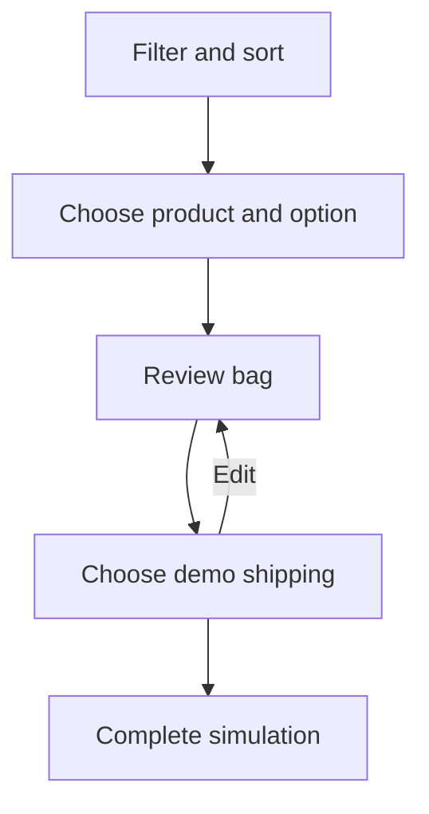

# Velvet Circuit Supply · Business and build notes

## Brief

Velvet Circuit Supply is a fictional direct-to-consumer shop for keyboard hobbyists, developers, gamers, artists and students. The After Hours collection has a PBT keycap kit, an artisan keycap, a desk mat, a coiled cable and a matching mat-and-cable bundle. Individual products, bundles and seasonal releases are the fictional revenue streams.

The primary journey is discover the collection → narrow by category, fit or stock → inspect fit, specs and options → manage the bag → simulate checkout. The main business problem is that shoppers can like the look of a product while remaining unsure whether it will fit their board or desk.

## Research and requirements

| Published observation | Design decision |
| --- | --- |
| Keychron's guide calls out ANSI/ISO and low-profile compatibility. | Put fit on each product and offer separate Standard MX and ANSI filters. Distinguish a single 1u artisan from a full ANSI kit. |
| NovelKeys lists dimensions, materials, inventory and maximum order quantities on a desk mat page. | Show metric mat sizes and finish, stock copy, and quantity limits by variant. |
| Baymard's research identifies filtering and sorting as mechanisms for finding a product in a catalog. | Use labeled native filters and sorts, explicit match counts and a clear-filters recovery path. |

[Keychron compatibility guide](https://www.keychron.com/blogs/news/switch-keycap-compatibility-check) · [NovelKeys product listing](https://novelkeys.com/products/ada-deskpad) · [Baymard product-list research](https://baymard.com/research/ecommerce-product-lists)

| Priority | Requirements |
| --- | --- |
| Must have | Mobile-friendly landing and catalog. Category, fit, stock and sorting controls. Product details with variants and availability, an editorial bundle recommendation, cart quantity and removal, shipping/returns and simulated checkout. Visible fictional labels and no sensitive inputs. |
| Should have | Test fit vocabulary and checkout findability with shoppers. Add shareable product detail links and second product angles. |
| Could have | Board-layout picker, save for later, richer matching bundles and simulated merchandising analytics. |
| Unnecessary for the portfolio MVP | Accounts, actual tax and payments, fulfillment, email collection, inventory synchronization or a marketing tracker. |

Prices, photos, stock, package contents and policies are fictional. The bundle has its own demo inventory count. Images illustrate styling and may include items outside the product's package.

## Wireframes and architecture

| Surface | Desktop | Phone |
| --- | --- | --- |
| Home | Brand and navigation, split headline and image, shop link | Brand and bag first, navigation on second row, stacked headline and image |
| Catalog | Inline filters and four-column product grid | Two-by-two filter controls and two-column card grid |
| Product detail | Modal with image beside fit, specs, options and action | Stacked scrollable modal with shorter image crop |
| Bag and checkout | Focus-managed modal with bag lines, subtotal, shipping and confirmation | Same progression in a narrow modal, wrapping action row |
| Bundle and policies | Editorial split section and disclosures | Stacked sections and native disclosures |

## Stack decision

| Criterion | Plain HTML/CSS/JS | Vite + React | Astro |
| --- | --- | --- | --- |
| Speed and cost | Immediate setup, no license or hosting charge for this demo | Free tooling, setup and build required | Free tooling, template and build setup |
| Maintenance | One catalog and two DOM flows, no dependencies | Dependency and build updates, component reuse | Dependency and build updates, content templates |
| Performance | Static files, deferred script, WebP | Bundled output with client runtime | Static output with selective hydration |
| Hosting | Direct GitHub Pages branch deployment | Deploy output with project base path | Deploy static output with project base path |
| Security and functions | Browser-only state, no endpoints or credentials | Same static boundary plus dependency review | Same static boundary plus dependency review |
| Scale and skills | Good for five products, DOM, native dialogs and money math | Useful for richer shared state and component practice | Useful for many indexable product pages and content management |

Selected buildless HTML/CSS/JS for the first release. Product details live in dialogs in this release. The bag stores variant keys and quantities in localStorage, with an in-tab fallback if storage fails. Integer cents keep arithmetic consistent. A larger indexable catalog would justify dedicated pages and shared templates. [GitHub Pages limits](https://docs.github.com/en/pages/getting-started-with-github-pages/github-pages-limits) · [Vite static deployment](https://vite.dev/guide/static-deploy.html) · [Astro Pages deployment](https://docs.astro.build/en/guides/deploy/github/)

## Build log

November 14, 2026 · v0.1.0. Defined the phone and desktop journey around fit and variants. Built the static storefront and cart in HTML/CSS/JS. Generated a hero and four standalone product crops, then resized and compressed them with Pillow. Initialized a dedicated GitHub repository and used GitHub Pages branch deployment. Public browser observations are maintained in the portfolio handoff.
